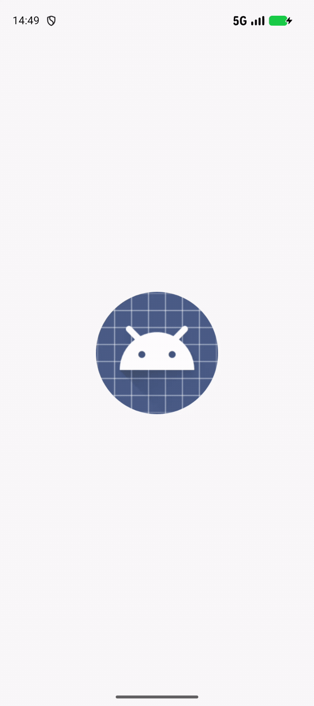

<h1 align="center">NFC Kit</h1>

<p align="center">
  <strong>Fake NFC tags for Android emulators.</strong><br>
  <sub>Inject tags from <code>adb</code> and exercise the same reader-mode, foreground-dispatch and cold-start paths your app uses in production — without a physical tag or an NFC radio.</sub>
</p>

<p align="center">
  <a href="https://jitpack.io/#igarciadelamo/nfc-kit"></a>
  <a href="https://github.com/igarciadelamo/nfc-kit/actions/workflows/ci.yml"></a>
  <a href="LICENSE"></a>
  
</p>

---

## Demo

<p align="center">
  
</p>

`nfc-tap.sh` sends `scripts/examples/uri-text.json` to the sample app while it is
open. The tag arrives through reader mode and the app shows the delivered UID and
NDEF records.

```bash
scripts/nfc-tap.sh es.igarciadelamo.nfctest.sample scripts/examples/uri-text.json
```

## Why nfc-kit?

Android emulators have no NFC radio. Testing tag discovery normally needs
physical tags, a hardware device or a custom build of your app.

In debug builds the `:nfc-test` module fabricates an `android.nfc.Tag` with an
`NdefMessage`, injects it from `adb`, and lets your app receive it through the
lifecycle it already implements. No test-only branches in your app.

> **Names:** *NFC Kit* is the project and the artifact family. `:nfc-reader` is
> the production module and the only one that ships in release; `:nfc-test` is
> the debug-only injection module. The repository root is `nfc-kit`; there is no
> module with that name.

- **Reader mode, foreground dispatch and cold start** — pick the path you want to test.
- **Automatic delivery** — `auto` mode uses the reader when enabled, falls back to an intent.
- **Declarative tags** — describe UID and NDEF records in a small JSON file.
- **Debug-only** — the injection module never ships in release builds.
- **Verified locally** — instrumented suites run on API 30, 34 and 36 managed
  devices, outside CI.

> **Scope:** the `:nfc-test` module is compiled into the app under test as a
> debug-only dependency. It cannot inject tags into a third-party APK or a
> release build. Reader mode is the only production code change: tags must be
> read through `NfcReaders`. Foreground and implicit delivery reuse the intent
> filters and NFC handling the app already has.

## How it works

```
adb broadcast ──► NfcTestReceiver ──► TagDispatcher ──┬─► InjectableNfcReader ──► app callback
                                                      └─► Intent (foreground / implicit)

adb shell am start ──► NfcTestLaunchActivity ──► NfcIntentResolver ──► Intent (cold start)
```

The debug provider installs `InjectableNfcReader` in `NfcReaders.factory` before
`Application.onCreate`, and the receiver runs in the app process so the fabricated
tag is usable there. Release builds have no provider, so `NfcReaders.get()` returns
the real platform reader.

## Modules

| Module | Build | Purpose |
| --- | --- | --- |
| `:nfc-reader` | `implementation` | Production `NfcReader` facade, `RealNfcReader` and `NfcReaders`. Platform NFC only. |
| `:nfc-test` | `debugImplementation` | Debug-only receiver, init provider, tag factory and cold-start trampoline. |
| `:sample` | demo | Minimal app showing reader mode and intent delivery. |
| `:sample-e2e` | tests | UiAutomator cold-start test against the sample. |

`:nfc-reader` is the only module that ships in release. It contains no test
code: it is the reader-mode facade plus the `NfcReaders` swap point that
`:nfc-test` replaces in debug builds.

## Requirements

- JDK 17 or newer.
- Android SDK with `compileSdk` 37 to build this repository. The AARs declare
  `minCompileSdk` 30, so consumer apps can compile with 30 or newer.
- AOSP API 30, 34 and 36 system images for Gradle Managed Devices.

## Getting started

### 1. Add the dependencies

Inside this repository the modules are consumed as projects:

```kotlin
dependencies {
    implementation(project(":nfc-reader"))
    debugImplementation(project(":nfc-test"))
}
```

A consuming app uses the published coordinates instead; see [JitPack](#jitpack).

### 2. Read tags through the facade

Call `enable()` from `onResume` and `disable()` from `onPause`. In debug builds a
`ContentProvider` installs an injectable reader before `Application.onCreate`;
release builds get the real platform reader.

```kotlin
class MyActivity : Activity() {
    private val reader = NfcReaders.get()

    private val callback = TagCallback { tag ->
        // Runs on the reader thread, never on the main thread.
        val uid = tag.id.joinToString("") { "%02X".format(it) }
    }

    override fun onResume() {
        super.onResume()
        when (reader.enable(this, callback)) {
            EnableResult.ENABLED -> Unit
            else -> showNfcUnavailable() // NO_ADAPTER or NFC_DISABLED
        }
    }

    override fun onPause() {
        reader.disable(this)
        super.onPause()
    }
}
```

### 3. Send a tag

```bash
scripts/nfc-tap.sh <package> scripts/examples/uri-text.json
```

Or call the broadcast directly:

```bash
adb shell am broadcast -a es.igarciadelamo.nfctest.TAP -p <pkg> -f 32 \
  --es tag_b64 <b64> --es mode auto
```

`-f 32` sets `FLAG_INCLUDE_STOPPED_PACKAGES`, so a freshly installed app in the
stopped state still receives the broadcast.

| Mode | Behaviour | Change in your app |
| --- | --- | --- |
| `auto` *(default)* | Reader if enabled, otherwise foreground, otherwise implicit. | Whatever the chosen path needs. |
| `reader` | Delivers to the active reader-mode callback. | Read through `NfcReaders.get()` and call `enable()` / `disable()`. |
| `foreground` | Starts the resumed activity with the foreground-dispatch intent. | Handle the NFC intent in `onNewIntent()`. No new code. |
| `implicit` | Starts an activity through the NDEF/TECH/TAG intent cascade. | Declare the intent filters. No code change. |

`foreground` and `implicit` require a foreground activity; without one they
return `result=3`.

| Result | Meaning |
| --- | --- |
| `1` | Delivered or launched. |
| `2` | Invalid tag. |
| `3` | No destination. |
| `4` | No reader. |
| `5` | Unexpected error. |

For `implicit` and cold start, the destination activity needs the usual NFC
intent filters. This is all a URL tag needs:

```xml
<activity
    android:name=".TagActivity"
    android:exported="true"
    android:launchMode="singleTop">
    <intent-filter>
        <action android:name="android.nfc.action.NDEF_DISCOVERED" />
        <category android:name="android.intent.category.DEFAULT" />
        <data android:scheme="https" />
    </intent-filter>
    <intent-filter>
        <action android:name="android.nfc.action.TAG_DISCOVERED" />
        <category android:name="android.intent.category.DEFAULT" />
    </intent-filter>
</activity>
```

`foreground` does not use these filters: it delivers to the resumed activity, so
handle the intent in `onNewIntent()`. `implicit` and cold start resolve
NDEF → TECH → TAG against them. A `TECH_DISCOVERED` filter also needs a
`meta-data` tech list, which is not evaluated yet (see
[Known limitations](#known-limitations)).

## Cold start

`NfcTestLaunchActivity` is a translucent trampoline that builds the tag,
resolves the NDEF → TECH → TAG cascade and forwards the intent. Launching it from
the shell avoids the background-activity restriction, and the destination still
sees the normal NFC extras. It reuses the destination's intent filters and its
`onCreate()` intent handling, so no test-only code is needed.

```bash
scripts/nfc-tap.sh --cold <package> scripts/examples/uri-text.json
```

The script `force-stop`s the app, waits for the `cold id=<id> result=<code>`
logcat line, prints `pid before=... after=...`, and exits non-zero unless the
result is `1`. It honors `ANDROID_SERIAL`; pass `--keep-process` to skip the
`force-stop` and launch into the running process instead.

The activity is debug-only and guarded by `android.permission.DUMP`. The debug
extra `--ez no_destination true` forces the "no destination" branch for testing.
The trampoline that reads it is rejected in release builds by
`verifyReleaseHasNoNfcTest`.

## Tag format

```json
{
  "uid": "01020304",
  "readOnly": false,
  "records": [
    {"type": "uri", "value": "https://example.com"},
    {"type": "text", "lang": "en", "value": "hello"},
    {"type": "mime", "mime": "text/vcard", "valueBase64": "..."},
    {"type": "external", "domain": "example.com", "typeName": "t", "valueBase64": "..."}
  ]
}
```

| Record | Fields |
| --- | --- |
| `uri` | `value` |
| `text` | `value`, optional `lang` (defaults to `en`) |
| `mime` | `mime`, `valueBase64` |
| `external` | `domain`, `typeName`, `valueBase64` |

`uid` is required and must be 4, 7 or 10 bytes in hex; at least one record is
required, and the message is limited to 16 KiB.

See [`scripts/examples/`](scripts/examples) for ready-to-use tags.

## JitPack

The libraries are published from git tags. Add JitPack and depend on the modules
you need:

```kotlin
repositories {
    maven { url = uri("https://jitpack.io") }
}

dependencies {
    implementation("com.github.igarciadelamo.nfc-kit:nfc-reader:0.2.2")
    debugImplementation("com.github.igarciadelamo.nfc-kit:nfc-test:0.2.2")
}
```

`:nfc-test` brings `:nfc-reader` transitively in debug builds. Keep the explicit
`:nfc-reader` dependency for release builds.

## Verification

CI runs the JVM tests, the debug/release builds and the release guard:

```bash
./gradlew testDebugUnitTest assembleDebug assembleRelease :sample:verifyReleaseHasNoNfcTest
```

The managed-device suites are **not** run in CI; run them locally:

```bash
./gradlew assembleDebugAndroidTest
./gradlew :nfc-test:allDevicesGroupAndroidTest
./gradlew :sample:allDevicesGroupAndroidTest
./gradlew :sample-e2e:allDevicesGroupAndroidTest
```

To check the published artifacts locally:

```bash
./gradlew publishToMavenLocal
```

For an external check, build a separate app against the JitPack coordinates with
`compileSdk` 30 or newer, then run reader mode and `scripts/nfc-tap.sh --cold`
against it.

The `REFLECTION` tag strategy needs `hidden_api_policy=1` while the emulator
boots. Without it, the `REFLECTION` cases are skipped instead of failing.

<details>
<summary>Running managed devices one at a time</summary>

`maxConcurrentDevices=1` in `gradle.properties` keeps Gradle Managed Devices from
starting more than one emulator at a time. To run one module and one API per
command, use the per-API task names:

```bash
./gradlew :nfc-test:api30DebugAndroidTest
./gradlew :nfc-test:api34DebugAndroidTest
./gradlew :nfc-test:api36DebugAndroidTest
```

The same pattern applies to `:nfc-reader`, `:sample` and `:sample-e2e`. The
`allDevicesGroupAndroidTest` aliases run a module across all three APIs.

</details>

## Known limitations

- **No card emulation or peer-to-peer.** The tag is fabricated inside your app.
  There is no HCE and no phone-to-phone NFC.
- **No NDEF I/O.** The injected `Tag` carries discovery metadata (`id`,
  `techList`, `cachedNdefMessage`) but has no `INfcTag`, so `connect()`,
  `readNdefMessage()` and `writeNdefMessage()` fail.
- **Tech-list XML is not evaluated.** `ACTION_TECH_DISCOVERED` resolves by action
  only; the `meta-data` tech lists are ignored.
- **`singleTask` is not verified.** Foreground dispatch is tested with
  `singleTop`; a `singleTask` destination has not been verified.
- **`getReferrer()` differs.** A cold-start destination sees the app itself as
  referrer, not `null` as with the platform.
- **Foreground and implicit need a resumed activity.** From the background both
  return `result=3`; use `--cold` for closed or background apps.
- **Debug builds only.** The module cannot target a third-party APK or a release
  build. Never ship `:nfc-test` in release.

## Documentation

| Document | Contents |
| --- | --- |
| [`docs/ARCHITECTURE.md`](docs/ARCHITECTURE.md) | Module map, delivery flow and lifecycle. |
| [`docs/STEP2_RESULTS.md`](docs/STEP2_RESULTS.md) | Delivery and dispatch test results. |
| [`docs/COLD_START_RESULTS.md`](docs/COLD_START_RESULTS.md) | Cold-start implementation and results. |
| [`docs/SPIKE_RESULTS.md`](docs/SPIKE_RESULTS.md) | Tag fabrication spike. |
| [`docs/PARCEL_LAYOUTS.md`](docs/PARCEL_LAYOUTS.md) | `Tag` parcel layouts per API level. |

## License

Apache License 2.0. See [LICENSE](LICENSE) and [NOTICE](NOTICE).
